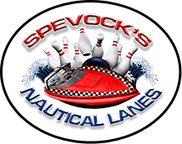

##  {#spevocks-nautical-lanes}

::: {layout-ncol=2}

::: {}

::: {.tour-location-image style="background-image: url(\"images/spevocks-nautical-lanes-image.jpg\")"}
:::

:::

::: {}

```{r}
#| output: true
latitude <- 41.4967654
longitude <- -82.0638213
loc_url <- "https://www.nauticalbowling.com/"
loc_name <- "Spevock's Nautical Lanes"
loc_street <- "184 Miller Road"
loc_city <- "Avon Lake, OH 44012"
loc_phone <- "(440) 933-7008"
leaflet(height = "300px") |>
  addTiles() |>
  setView(
    lng = longitude,
    lat = latitude,
    zoom = 15
  ) |>
  addMarkers(
    lng = longitude,
    lat = latitude,
    popup = paste(
      sprintf(
        fmt = "<b><a href='%s' target=_blank>%s</a></b>",
        loc_url,
        loc_name
      ),
      loc_street,
      loc_city,
      loc_phone,
      sep = "<br>"
    ),
    popupOptions = popupOptions(closeButton = FALSE)
  ) |>
  addPopups(
    lng = longitude + 0.00005,
    lat = latitude + 0.0011,
    popup = paste(
      sprintf(
        fmt = "<b><a href='%s' target=_blank>%s</a></b>",
        loc_url,
        loc_name
      ),
      loc_street,
      loc_city,
      loc_phone,
      sep = "<br>"
    ),
    options = popupOptions(closeButton = FALSE)
  )
```

:::

:::
