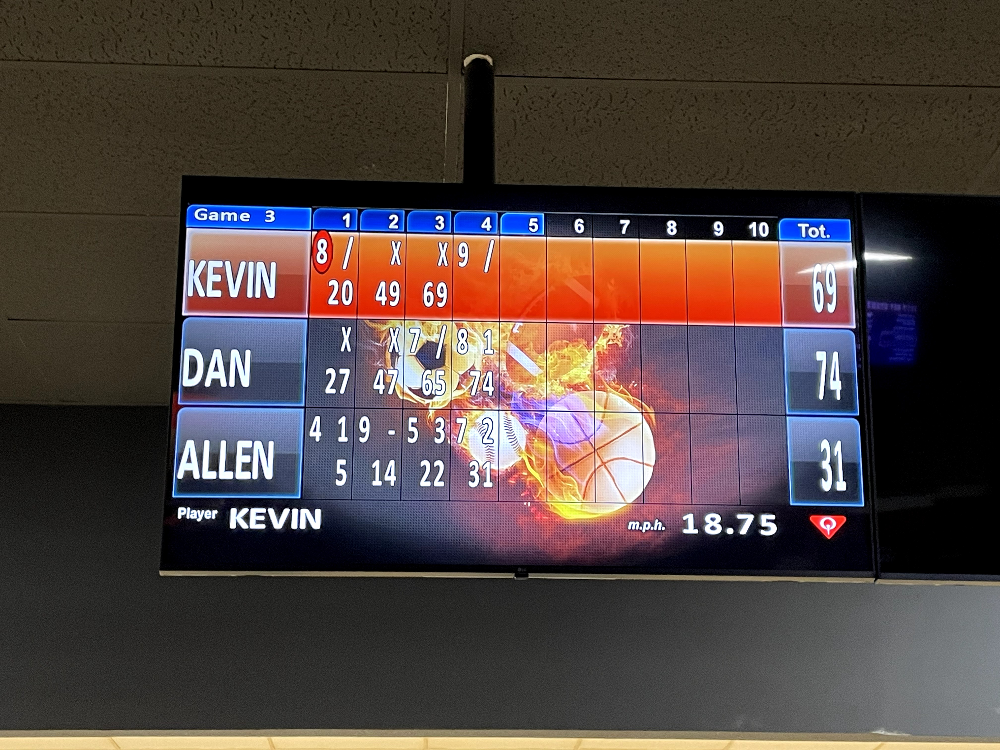
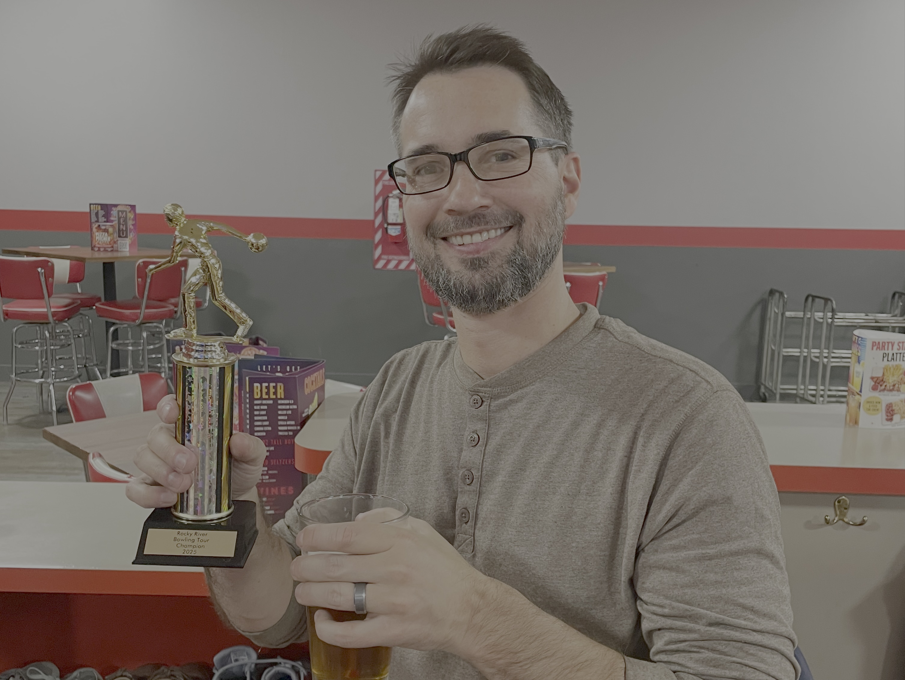
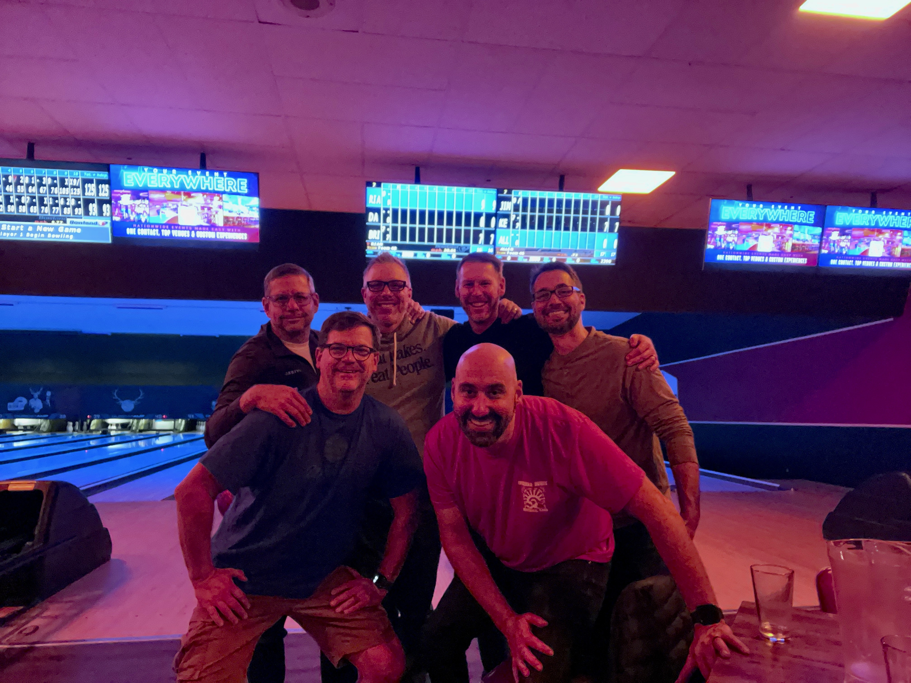

```{r}
#| file: R/setup.R
```

# 2026

## Spring Classic {#spring-classic-2026-media}

The tour's [first event outside Cuyahoga County](../events#spring-classic-2026)
took place at
[AMF North Ridgeville Lanes](../locations#amf-north-ridgeville-lanes). The crew
bowled two good games before closing time cut short a strong start to game 3. A
brief visit to Time Warp in Westlake took place after.

::: {#media-spring-classic-2026 layout-ncol=2}



](images/spring-classic-2026-postgame.jpg)

:::

## Super Bowl Eve Open {#super-bowl-eve-open-2026-media}

::: {#media-super-bowl-eve-open-2026}

The group celebrated after the event by raising a toast to co-founder Dan
Negrey who bowled his first career 200 game earlier in the evening! This was
also the first 200 game bowled on the tour. Congratulations Dan!

](images/super-bowl-eve-open-2026-postgame.jpg)

:::

# 2025

## Tour Championship {#tour-championship-2025-media}

::: {#media-tour-championship-2025 layout-ncol=3}

](images/tour-championship-2025-pregame.jpg)





:::


